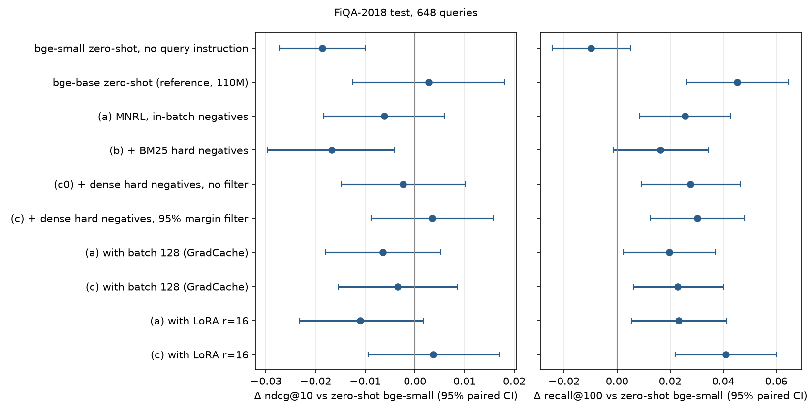

# fiqa-embed-ft

How much does in-domain fine-tuning help a small (33M-parameter) embedding model on
financial question-answer retrieval, which kind of hard negatives is worth mining, and
what does it cost on one 8 GB laptop GPU? This repo fine-tunes `BAAI/bge-small-en-v1.5`
on the FiQA-2018 training split (BEIR version) with MultipleNegativesRankingLoss and
compares in-batch negatives, BM25-mined hard negatives, and dense-mined hard negatives
with and without a false-negative filter. Learning rate and epoch are chosen on the dev
split; the test split (648 queries, 57,638 documents) is scored once per trained model,
and every comparison has a query-level bootstrap CI, a paired permutation test and a
Holm correction over all 38 tests reported.

**TL;DR**

- **Filtered dense hard negatives beat in-batch fine-tuning:** +0.0096 nDCG@10
  [95% CI +0.005, +0.014], Holm-adjusted p=0.004, 3 seeds. It is the only comparison
  between fine-tuning arms that survives the correction.
- **Against the zero-shot model, fine-tuning moves recall, not the top 10.** No arm
  changes nDCG@10 significantly. The filtered dense arm raises Recall@100 by +0.030
  (Holm p=0.042). For in-batch and BM25 negatives, no fine-tuned epoch ever beat the
  untouched model on dev (3 of 3 seeds), so dev-based selection says: do not fine-tune.
- **Evaluation matches MTEB and runs are cheap.** Zero-shot nDCG@10 is 0.4035 vs 0.40343
  author-reported on MTEB. A full fine-tune takes 1.5 to 6 minutes of training and at
  most 4.0 GB of GPU memory on an RTX 5070 Laptop.



## How this was built

This project was built with [Claude Code](https://claude.com/claude-code), an AI coding agent.
All 10 commits made on September 28–29, 2026 (US Eastern) carry a `Co-Authored-By: Claude`
trailer, and later README edits were also made with Claude Code. The numbers in this README come
from the scripts and result files in this repository.

## Results

FiQA-2018 test split, full-corpus exact search, 512-token documents, fp32 inference.
Rows with 3 seeds give the seed mean ± SD; their CIs and p-values use per-query scores
averaged over seeds. Δ is the paired difference on the same 648 queries (10,000
bootstrap resamples for CIs, 10,000 sign flips for p). p is Holm-adjusted over the 38
tests in [results/summary.md](results/summary.md); with 10,000 resamples the smallest
reachable adjusted p is 0.004. That file also has the ablation rows (batch 128 via
GradCache, LoRA), R@10, MRR@10 and per-seed dev epochs. Per-query scores are in
`results/runs/*.json`.

| System | Seeds | nDCG@10 | Δ nDCG@10 vs zero-shot [95% CI], Holm p | R@100 | Δ R@100 vs zero-shot, Holm p | Train s | Peak VRAM GB |
|---|---|---|---|---|---|---|---|
| BM25 (bm25s, stemmed) | - | 0.2514 | -0.152 [-0.176, -0.129], p=0.004 | 0.559 | -0.137, p=0.004 | | |
| **bge-small zero-shot** | - | **0.4035** | | 0.696 | | | |
| (a) MNRL, in-batch negatives | 3 | 0.3973 ± 0.0026 | -0.006 [-0.018, +0.006], p=1.000 | 0.722 | +0.026, p=0.139 | 96 | 2.41 |
| (b) + BM25 hard negatives | 3 | 0.3867 ± 0.0024 | -0.017 [-0.030, -0.004], p=0.260 | 0.713 | +0.016, p=1.000 | 168 | 4.00 |
| (c0) + dense hard negatives, no filter | 3 | 0.4011 ± 0.0024 | -0.002 [-0.015, +0.010], p=1.000 | 0.724 | +0.028, p=0.108 | 337 | 4.00 |
| (c) + dense hard negatives, 95% margin filter | 3 | **0.4069** ± 0.0031 | +0.003 [-0.009, +0.016], p=1.000 | **0.726** | +0.030, p=0.042 | 337 | 4.00 |

Between fine-tuning arms (same file): (c) vs (a) +0.0096 nDCG@10, Holm p=0.004;
(c) vs (c0) +0.0058 [-0.000, +0.012], raw p=0.057, Holm p=1.000; (c0) vs (a) +0.0038,
raw p=0.255; (b) vs (a) -0.0106, raw p=0.002, Holm p=0.065.

What the numbers say:

- **The zero-shot baseline reproduces the reference.** bge-small nDCG@10 is 0.4035
  against 0.40343, and bge-base 0.4062 against 0.40646. Both references are the
  model authors' own submissions in the MTEB results repository (`external/` folder,
  pinned commit, [results/published_mteb.json](results/published_mteb.json)). So the
  evaluation code (metrics, query instruction, 512-token documents, exact search)
  matches theirs.
- **Dense negatives plus the filter help relative to in-batch negatives, but the
  filter's own share is not established.** (c) beats (a) clearly. The two steps that
  make up the difference, adding dense negatives ((c0) vs (a), +0.004) and adding the
  filter ((c) vs (c0), +0.006, raw p=0.057), are each too small to separate from noise
  on 648 queries.
- **BM25 negatives are the worst arm.** They lower nDCG@10 against in-batch negatives
  by 0.011 (raw p=0.002). After Holm correction this is no longer significant (0.065).
- **Dev says in-batch and BM25 fine-tuning are not worth it.** Every run of (a) and (b),
  and both batch-128 runs, scored below the base model on dev at every epoch, so early
  stopping ended them after 2 of 4 epochs. Their test numbers come from the best
  fine-tuned epoch, to answer the research question, but the model you would ship
  under this protocol is the base model.
- **Larger batches did not help here.** In-batch at batch 128 (GradCache) is -0.0003
  nDCG@10 against batch 32. This is one seed, and it is confounded: at the same
  lr, batch 128 takes 4x fewer optimizer steps (111 per epoch vs 443).
- **Cost.** Train time excluding dev evaluation ranged from 93 s (in-batch) to 342 s
  (dense arms, 4 epochs); LoRA on arm (c) took 534 s. Dev evaluation costs about 45 s
  per epoch (84 s with LoRA), and mining dense candidates about 46 s. Peak memory was
  2.41 GB for pairs, 4.00 GB for triplets and 2.20 GB with GradCache mini-batches of 32.
  LoRA did not lower peak memory (2.70 / 4.76 GB). This was not profiled; one possible
  explanation is that activations, not the optimizer state of 33M parameters, dominate at
  this size.

**Learning-rate search** ([results/sweep/summary.md](results/sweep/summary.md)): dev
only, seed 1, grid 5e-6 to 1e-4, same epoch cap and early stopping as the final runs.
The rule, fixed before the sweep ran, was to use the lr with the best mean dev nDCG@10
over the two swept arms (a) and (c). 5e-6 won by 0.00005 over 1e-5, which is a tie in
practice. The filtered arm alone peaks at 1e-5 (bracketed by 5e-6 and 2e-5). The
in-batch arm never beats the base model at any lr, so its preferred lr is as close to
"no training" as the grid allows, and the grid cannot bracket it from below.

**Checks behind two shortcuts** ([results/eval_conditions.json](results/eval_conditions.json),
zero-shot model, dev split): 19.2% of FiQA documents are longer than 256 tokens (4.2%
longer than 512), which is what the 256-token training truncation cuts. fp16 autocast
during dev evaluation gives 0.4090 nDCG@10 vs 0.4094 in fp32; every dev score,
including the base model's epoch-0 score, uses fp16, so selection compares like with like.

**Mining** ([results/mining/](results/mining/)): with the 95% margin rule, 3,601 of
14,166 training pairs (25.4%) had no candidate in the top 1,000 below
0.95 x cos(query, positive), so they got a random negative instead. The negatives are
drawn once per training seed from the same candidate lists.

Hardware and software: RTX 5070 Laptop GPU (8 GB), i9-14900HX, Windows 11. Exact
package versions are in [requirements-lock.txt](requirements-lock.txt) (PyTorch
2.9.0+cu129, sentence-transformers 6.1.0, transformers 5.17.0) and in each run record.
Peak VRAM is `torch.cuda.max_memory_allocated` during training, including per-epoch dev
evaluation.

### Revision note

The first published version scored dev during training with documents truncated to
256 tokens, while the zero-shot dev baseline and test used 512. That made the lr search
and best-epoch choice optimize a different task than the one tested (at 256 tokens the
zero-shot dev score drops from 0.409 to 0.399). The evaluator now switches to 512 tokens
and has a test for it. The base model now enters selection as epoch 0, early stopping
can end a run (4-epoch cap, patience 2), negatives are drawn per seed, and the lr sweep
and all trained runs were rerun. The earlier test numbers had been seen. The protocol
changes were motivated by review of the code and of dev results, not by test scores.

## Architecture

```
BeIR/fiqa + BeIR/fiqa-qrels (HF Hub, pinned revisions)
        |
   fiqa_ft/data.py ---- corpus, queries, qrels{train,dev,test}
        |
        +--> scripts/mine.py  --(BM25 | base-model dense top-1000)--> fiqa_ft/mining.py
        |        filters: drop labelled positives, skip_top, margin x cos(q, pos)
        |        -> artifacts/negatives_<name>_seed<k>.jsonl   (1 negative per pair)
        |
        +--> scripts/train.py  (sentence-transformers Trainer, MNRL or GradCache MNRL,
        |        bf16, no-duplicate batches, 256-token training inputs, batch 32)
        |        fiqa_ft/training.py: dev nDCG@10 at 512 tokens for the base model and
        |        after each epoch; early stop; restore best fine-tuned epoch
        |        -> test retrieval once -> results/runs/<run>.json (per-query scores)
        |
        +--> scripts/evaluate.py (zero-shot models, BM25)
        |
   scripts/summarize.py -- fiqa_ft/stats.py (bootstrap, sign-flip test, Holm)
        -> results/summary.{md,json}, results/sweep/summary.md, results/deltas.png
```

`fiqa_ft/retrieval.py` does exact cosine search on the GPU (chunked `q @ D.T` +
`topk`) and BM25 through `bm25s`; `fiqa_ft/metrics.py` implements nDCG/Recall/MRR with
trec_eval definitions.

## Quickstart / Reproduce

```bash
python -m venv .venv && source .venv/bin/activate   # Windows: .venv\Scripts\activate
pip install -r requirements-lock.txt --extra-index-url https://download.pytorch.org/whl/cu129
pip install -e . --no-deps

pytest -q && ruff check .                     # CPU-only tests, no downloads

python scripts/evaluate.py --name baseline_bge-small   # zero-shot, about 2 min on GPU
bash scripts/sweep_lr.sh                               # dev-only lr search, about 1.5 h
bash scripts/run_all.sh                                # everything in results/, about 3 h
```

`run_all.sh` skips any result file that already exists, so delete the files under
`results/runs/` that you want to recompute. Mined negatives are regenerated into
`artifacts/` (gitignored). No model weights are saved or uploaded. The lockfile was
frozen on Windows; on Linux, `pip install torch --index-url
https://download.pytorch.org/whl/cu129` followed by `pip install -e ".[train,dev]"` also
works, with versions that may differ from the ones used here.

## Design decisions

- **Exact search over approximate search.** 57,638 x 384 embeddings fit easily in
  GPU memory, and exact top-k removes ANN recall loss as a confounder.
- **Dev is scored under test conditions, and the base model is a candidate.** Training
  truncates to 256 tokens for memory, but the evaluator switches to 512 for dev, like
  test. Scoring the untouched model as epoch 0 lets dev say "fine-tuning did not help",
  which it did for arms (a) and (b).
- **The margin filter is relative to each positive's own score**
  (TopK-PercPos from NV-Retriever, [arXiv:2407.15831](https://arxiv.org/abs/2407.15831)).
  FiQA has about 2.6 labelled answers per query and many unlabelled correct ones, so
  the candidates that look most like the positive are often unlabelled positives.
  A fixed rank cutoff (`--skip-top`) is also implemented and tested, but it was not
  one of the evaluated arms.
- **No-duplicate batches.** A query with several positives would otherwise appear
  twice in a batch, and each copy's positive would become a false in-batch negative
  for the other.
- **Best weights kept in memory, not in checkpoints.** The evaluator copies the state
  dict (about 130 MB) when dev nDCG@10 improves. Nothing is written to disk, and the
  same code serves full fine-tuning and LoRA.
- **Queries as the unit of resampling, Holm across all tests.** Seed-to-seed SD is at
  most 0.0031 nDCG@10 (with negatives redrawn per seed), while the 648-query sample
  gives a CI of about ±0.028, so the tests resample queries. 38 paired tests are
  reported, so p-values are Holm-adjusted rather than read one at a time.

## Limitations

- Early stopping counts the base model: if epochs 1 and 2 both score below it, the run
  stops. In-batch runs at lr 5e-6 were still rising at epoch 2 (for example 0.3987 then
  0.4081 on dev, base 0.4090), so a longer run might have passed the base model.
- The filtered dense arm reached its best dev score at the 4-epoch cap in 2 of 3 seeds.
- One lr was used for every full fine-tune, tuned on arms (a) and (c) and reused for
  (b) and (c0). The LoRA runs use an untuned lr of 2e-4 and one seed; the batch-128
  runs use one seed and the batch-32 lr.
- The margin arm is partly a mixture: 25.4% of its pairs got random, easy negatives
  because no candidate passed the filter. This was not separated from the effect of
  removing likely false negatives.
- One dataset, one base model. It is not known whether FiQA-like data was part of the
  bge-v1.5 training mix, which would explain why fine-tuning adds so little.

**Possible next steps:** let early stopping measure improvement over the best
fine-tuned epoch rather than the base model, and raise the epoch cap; replace the
random fallback in the margin arm with the next-best candidate below the margin to
isolate the filter's effect; tune lr per arm.

## Data and model licenses

- FiQA-2018 via BEIR: [BeIR/fiqa](https://huggingface.co/datasets/BeIR/fiqa) and
  [BeIR/fiqa-qrels](https://huggingface.co/datasets/BeIR/fiqa-qrels), listed as
  CC BY-SA 4.0 on the Hugging Face Hub. Original task: FiQA 2018 open challenge
  (Maia et al., WWW'18 companion). BEIR: Thakur et al., NeurIPS 2021 Datasets and
  Benchmarks. The data is downloaded at runtime and not stored in this repo.
- [BAAI/bge-small-en-v1.5](https://huggingface.co/BAAI/bge-small-en-v1.5) and
  bge-base-en-v1.5: MIT.
- Reference scores: [embeddings-benchmark/results](https://github.com/embeddings-benchmark/results).

## License

MIT, copyright 2026 Yunlong Lu. See [LICENSE](LICENSE).
